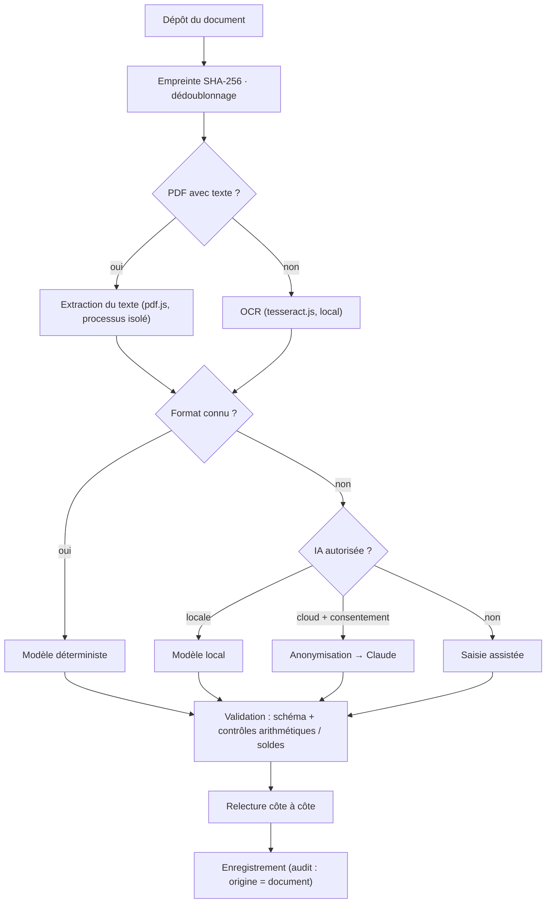

# Analyse de documents & IA

Conception du pipeline de lecture des relevés et bulletins (jalon [M7](../planning/M7-documents-ia.md)). Principe : **déterministe d'abord, IA ensuite, humain en dernier**.

## Pipeline



## Fournisseurs

```ts
/** Contrat commun ; la sortie est toujours validée par le schéma métier (zod). */
interface AiProvider {
  readonly id: 'none' | 'local' | 'anthropic'
  readonly runsOnDevice: boolean
  extractPayslip(input: ExtractionInput): Promise<ExtractionResult<PayslipDraft>>
  extractStatement(input: ExtractionInput): Promise<ExtractionResult<StatementDraft>>
  suggestCategories(labels: string[]): Promise<CategorySuggestion[]>
}
```

| Fournisseur | Fonctionnement                                                                                                                                                                                                                                                                                                                        | Données envoyées                               | Par défaut                                                                                                      |
| ----------- | ------------------------------------------------------------------------------------------------------------------------------------------------------------------------------------------------------------------------------------------------------------------------------------------------------------------------------------- | ---------------------------------------------- | --------------------------------------------------------------------------------------------------------------- |
| `none`      | Modèles déterministes + saisie assistée                                                                                                                                                                                                                                                                                               | Aucune                                         | ✅                                                                                                              |
| `local`     | **Petit modèle spécialisé embarqué** (quelques centaines de Mo, téléchargé à la demande, empreinte vérifiée) pour les champs non couverts par les modèles déterministes ; ou, en option avancée, un serveur d'inférence local déjà installé (Ollama ou équivalent) pour un modèle plus capable ; sortie JSON contrainte par le schéma | Aucune hors de l'appareil                      | Recommandé ([ADR-017](decisions.md#adr-017--ia-locale-légère-par-défaut-recommandée-cloud-toujours-facultatif)) |
| `anthropic` | API Claude, **clé personnelle**, chiffrée par `safeStorage`, utilisée uniquement côté main                                                                                                                                                                                                                                            | Texte ou PDF **anonymisé**, après consentement | Non                                                                                                             |

Les modèles locaux ne sont **jamais** embarqués dans l'installeur : le modèle léger est téléchargé à la demande, comme les données de langue de l'OCR. Choix précis du modèle et du format (ONNX, GGUF…) : [Q2 des questions ouvertes](../planning/questions-ouvertes.md).

## Fournisseur Claude (implémenté en M7)

- **Modèles** : `claude-haiku-4-5` par défaut pour limiter les coûts ; `claude-sonnet-4-5` sélectionnable.
- **Sorties structurées sans SDK lourd** : appel HTTPS direct à `/v1/messages` (`anthropic-version: 2023-06-01`) via Node `fetch` + `output_config.format.json_schema` généré avec `z.toJSONSchema(schema)` ; toute réponse ne validant pas le schéma `zod` est rejetée.
- **Charge utile minimale** : seul le texte **extrait localement et anonymisé** (jamais d'octets bruts non expurgés) est envoyé après aperçu exact et consentement utilisateur.
- **Refus & plafond** : vérification explicite de `stop_reason === 'refusal'` ; calcul du coût estimé en micro-USD avant envoi et blocage au-delà du plafond mensuel configuré.
- **Localisation des traitements** : l'API cloud Anthropic traite les extraits hors de l'appareil (et possiblement hors de l'UE) → l'utilisateur en est informé avant confirmation dans la modale de consentement.

```ts
// Exécuté uniquement dans le process main (`src/main/documents/ai/anthropic.ts`).
const response = await fetcher('https://api.anthropic.com/v1/messages', {
  method: 'POST',
  headers: {
    'content-type': 'application/json',
    'x-api-key': apiKey,
    'anthropic-version': '2023-06-01',
  },
  body: JSON.stringify({
    model,
    max_tokens: 2048,
    system,
    messages: [{ role: 'user', content: anonymizedText }],
    output_config: { format: { type: 'json_schema', schema: z.toJSONSchema(schema) } },
  }),
})
```

## Confidentialité

1. **Consentement par document** (ou par lot explicitement choisi), révocable ; rappel du fournisseur et de la localisation des traitements.
2. **Anonymisation** avant envoi : NIR, IBAN, numéros de carte, noms et adresses remplacés par des jetons ; les montants et libellés comptables nécessaires restent.
3. **Aperçu** exact de ce qui sera envoyé.
4. **Journal local** des envois (date, fournisseur, type de document, taille) — jamais le contenu.
5. **Garde-fou technique** : aucun module ne peut joindre le réseau sans passer par le service d'envoi qui vérifie le consentement (testé).
6. **Pas de conservation du document original par défaut** ([ADR-018](decisions.md#adr-018--pas-de-conservation-des-documents-sources-par-défaut)) : une fois les données extraites et validées, le fichier déposé est supprimé ; seules les données structurées et une empreinte (anti-doublon) restent dans la base chiffrée. Un export du fichier original reste possible immédiatement après traitement, avant suppression, à la demande de l'utilisateur.

## Validation & relecture

- Validation par schéma (types, bornes, champs obligatoires).
- Contrôles métier : `checkPayslip` étendu (M6) pour les bulletins ; rapprochement des soldes (M3) pour les relevés.
- Score de confiance par champ ; champs incertains mis en évidence dans la vue côte à côte.
- Origine tracée (`document`, `ia:local`, `ia:anthropic`) dans le journal d'audit.

## Évaluation

- Corpus de documents **anonymisés** avec vérité terrain (contributions via l'outil d'anonymisation, proposition P-45).
- Mesures : précision et rappel par champ, taux de contrôles au vert, temps de relecture.
- Non-régression en CI sur des réponses enregistrées : **aucun appel réseau en CI**.
