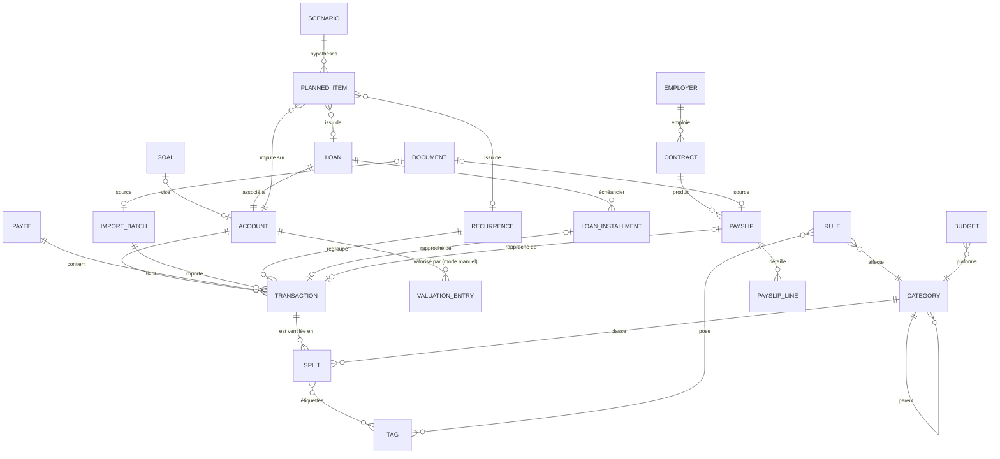

# Modèle de données

Modèle **cible** des données de Fluxo, introduit progressivement (M1 → M8). Il sera stocké dans une base SQLite chiffrée (SQLCipher) gérée par un service de données dédié.

## Règles transverses

| Règle             | Détail                                                                                                                                                                                       |
| ----------------- | -------------------------------------------------------------------------------------------------------------------------------------------------------------------------------------------- |
| Montants          | Entiers en **centimes** (`MinorUnits`) + code devise ISO 4217. Jamais de flottant. Les taux (cotisations, PAS) sont des décimaux stockés en millionièmes ou en texte décimal exact.          |
| Dates             | Date **calendaire** `AAAA-MM-JJ` pour les opérations (pas de fuseau) ; horodatages UTC ISO 8601 pour l'audit et les imports ; mois `AAAA-MM`.                                                |
| Identifiants      | UUIDv7 (triables dans le temps, compatibles avec une future synchronisation).                                                                                                                |
| Suppression       | Archivage plutôt que suppression pour les entités référencées (comptes, catégories) ; suppression réelle pour les opérations, tracée dans l'audit.                                           |
| Audit             | Toute écriture produit une entrée de journal (entité, avant/après, origine : saisie, import, règle, IA, système) ; journal en ajout seul ; une écriture en masse produit une entrée par lot. |
| Données sensibles | IBAN, NIR, adresses : chiffrés avec la base, masqués à l'affichage, jamais journalisés.                                                                                                      |

## Entités

| Entité                        | Champs principaux                                                                                                                                                                                                                                                                                                                                                                                                                                             | Jalon    |
| ----------------------------- | ------------------------------------------------------------------------------------------------------------------------------------------------------------------------------------------------------------------------------------------------------------------------------------------------------------------------------------------------------------------------------------------------------------------------------------------------------------- | -------- |
| **Account**                   | nom, type (courant, épargne, carte différée, espèces, titres-restaurant, placement, prêt, autre actif), mode de suivi (relevé importé, saisie manuelle ou valorisation manuelle — défaut selon le type, figé à la première opération, voir [ADR-026](decisions.md#adr-026--saisie-manuelle-réservée-aux-comptes-sans-relevé)), établissement, devise (figée à la première opération), solde et date d'ouverture, IBAN chiffré, couleur, icône, ordre, archivé | M2       |
| **Transaction**               | compte, date d'opération, date de valeur, montant, devise, montant converti, libellé brut, libellé affiché, tiers, statut (en attente, pointée, rapprochée), nature (opération, ajustement de solde — M3), note (obligatoire pour un ajustement), favori, lot d'import, empreinte de déduplication, lien de virement                                                                                                                                          | M2       |
| **Split**                     | transaction, catégorie, montant (Σ = montant de la transaction), étiquettes, note                                                                                                                                                                                                                                                                                                                                                                             | M2       |
| **Category**                  | nom, parent, type (dépense, revenu, épargne, transfert), compte lié (`linked_account_id`, facultatif sur une sous-catégorie de transfert/épargne), icône, couleur, ordre, archivée                                                                                                                                                                                                                                                                            | M2 / M5+ |
| **Payee**                     | nom canonique, alias, catégorie par défaut                                                                                                                                                                                                                                                                                                                                                                                                                    | M2 / M4  |
| **Tag**                       | nom, couleur ; indépendant des catégories, posé sur une ou plusieurs ventilations (une même dépense peut porter plusieurs étiquettes)                                                                                                                                                                                                                                                                                                                         | M2       |
| **ImportBatch**               | fichier (nom, empreinte), format, profil, compte, période, compteurs, état, date                                                                                                                                                                                                                                                                                                                                                                              | M3       |
| **Rule**                      | conditions, actions (catégorie et/ou étiquettes, renommage, marquer comme virement), priorité, active, statistiques d'application                                                                                                                                                                                                                                                                                                                             | M4       |
| **Recurrence**                | tiers, périodicité, montant attendu ± tolérance, prochaine échéance, historique de prix                                                                                                                                                                                                                                                                                                                                                                       | M4       |
| **ValuationEntry**            | compte (en mode valorisation manuelle), date, valeur, note — historique d'un actif externe (placement, immobilier…)                                                                                                                                                                                                                                                                                                                                           | M8       |
| **Loan**                      | compte associé, nom, type (immobilier, consommation, auto, étudiant, autre), capital initial, taux nominal, TAEG, assurance emprunteur, durée, date de début, périodicité, mensualité, capital restant dû, statut                                                                                                                                                                                                                                             | M8       |
| **LoanInstallment**           | prêt, numéro, date d'échéance, part capital, part intérêts, part assurance, capital restant dû après échéance, statut (prévue, payée, rapprochée), transaction liée                                                                                                                                                                                                                                                                                           | M8       |
| **Budget**                    | catégorie, période, montant ou %, report                                                                                                                                                                                                                                                                                                                                                                                                                      | M8       |
| **Goal**                      | nom, montant cible, échéance, compte                                                                                                                                                                                                                                                                                                                                                                                                                          | M8       |
| **Scenario**                  | nom, scénario de base ou variante (scénario d'origine), horizon (mois de fin), comptes inclus, indexation annuelle par défaut (millionièmes)                                                                                                                                                                                                                                                                                                                  | M8       |
| **PlannedItem**               | scénario, compte, libellé, catégorie, montant signé, périodicité (ponctuel, mensuel, trimestriel, annuel), date de début, date de fin, indexation annuelle (millionièmes), origine (récurrence, crédit, salaire, hypothèse ajoutée)                                                                                                                                                                                                                           | M8       |
| **Employer** · **Contract**   | raison sociale ; type, statut cadre, temps de travail, convention collective, dates                                                                                                                                                                                                                                                                                                                                                                           | M6       |
| **Payslip** · **PayslipLine** | voir ci-dessous                                                                                                                                                                                                                                                                                                                                                                                                                                               | M6       |
| **Document**                  | type, empreinte (anti-doublon), taille, pages, état de traitement, résultat d'extraction ; **pas de fichier original conservé par défaut** (supprimé après extraction — export facultatif avant suppression)                                                                                                                                                                                                                                                  | M7       |
| **SavedFilter**               | nom (unique), filtre (JSON), ordre — préférence d'affichage du registre, hors audit                                                                                                                                                                                                                                                                                                                                                                           | M2       |
| **AuditEntry**                | horodatage, entité, identifiant, avant, après, origine                                                                                                                                                                                                                                                                                                                                                                                                        | M1       |

### Étiquettes et corrélation transverse

Les étiquettes (`Tag`) sont posées sur la **ventilation** (`Split`), pas sur la transaction entière : une transaction non ventilée n'a qu'une seule part, le cas simple reste donc simple, et une transaction scindée peut porter des étiquettes différentes par part. Les étiquettes sont indépendantes des catégories et répondent à un besoin différent : une catégorie classe (une seule par part), une étiquette **corrèle** à travers les catégories (ex. l'étiquette « Abonnement téléphonique » peut regrouper des parts classées en « Télécom » comme en « Pro »). Les règles (M4) peuvent poser une catégorie, une ou plusieurs étiquettes, ou les deux. Voir [ADR-013](decisions.md#adr-013--étiquettes-posées-sur-la-ventilation-split-pas-sur-la-transaction).

### Épargne, patrimoine et crédits

- Un virement entre un compte courant et un compte d'**épargne** (livret, PEA, assurance-vie…) est classé dans une catégorie de type `épargne` (y compris les sous-catégories `Transfert ↔ <Compte>` liées automatiquement à chaque compte d'épargne via `linked_account_id`) : il n'est **ni une dépense, ni un revenu**, et contribue en **épargne nette** (+ pour un versement vers l'épargne, − pour un retrait depuis l'épargne vers le compte courant), sans double comptage lorsque les deux écritures sont reliées. Un virement entre deux comptes courants ou entre deux comptes d'épargne reste neutre (type `transfert`).
- Un compte en **mode valorisation manuelle** (placement, bien immobilier) n'a pas de transactions : sa valeur est une suite de `ValuationEntry` saisies périodiquement par l'utilisateur. Aucune cotation automatique par défaut (cohérent avec le principe local-first) ; une connexion facultative est envisagée après la v1 ([M10](../planning/M10-au-dela.md)).
- Un **crédit** (`Loan`) est représenté par un compte de type `prêt` associé à un échéancier (`LoanInstallment`) : capital et intérêts de chaque mensualité, capital restant dû après l'échéance, rapprochement facultatif avec la transaction de prélèvement. Le **patrimoine net** à une date donnée est une donnée dérivée : Σ comptes actifs (courant, épargne, placements valorisés) − Σ capital restant dû de tous les crédits.

### Ajustements de solde

Une opération de nature **ajustement** (D11, [ADR-025](decisions.md#adr-025--revue-des-propositions-du-24-novembre-2026)) comble un écart détecté par le rapprochement des soldes (D08) quand le relevé manquant n'est pas disponible. Elle est comptée dans le solde du compte, **exclue par défaut** des revenus, dépenses et agrégats de catégorie (son contenu réel est inconnu), porte obligatoirement une note, et est proposée à la suppression si un import ultérieur couvre la période de l'écart.

### Simulation à long terme

Un **scénario** (`Scenario`) projette mois par mois les soldes des comptes inclus jusqu'à son horizon. Le scénario de base est **dérivé** des données existantes : récurrences détectées (M4), échéances de crédit (`LoanInstallment`), salaire (M6). Ses éléments (`PlannedItem`) sont régénérés à la demande ; une variante copie le scénario de base puis ajoute, modifie ou supprime des éléments (nouvel abonnement, hausse annuelle de l'énergie, dépense ponctuelle, versement d'épargne). L'indexation est un taux en millionièmes appliqué une fois par an, arrondi au centime à chaque échéance ; les soldes projetés ne sont **pas stockés** (donnée dérivée, recalculée).

### Origine des opérations

Le **mode de suivi** du compte détermine d'où viennent ses opérations ([ADR-026](decisions.md#adr-026--saisie-manuelle-réservée-aux-comptes-sans-relevé)) :

- **Relevé importé** (défaut pour courant, épargne, carte à débit différé) : les opérations ne sont créées que par un import (M3) ou une écriture d'ajustement (D11). Montant, date et compte d'une opération importée ne sont pas modifiables ; on l'**annote** (libellé affiché, catégorie, ventilation, étiquettes, notes, lien de virement). Seule l'annulation de son lot d'import la retire. Le service de données refuse toute création manuelle sur un tel compte.
- **Saisie manuelle** (défaut pour espèces et titres-restaurant) : il n'existe pas de relevé à contredire, la saisie, la modification et la suppression sont libres. La contrepartie d'un virement depuis un compte bancaire (retrait au distributeur, rechargement) est créée en liant l'opération importée au compte saisi.
- **Valorisation manuelle** (placement, immobilier) : pas d'opérations, une suite de `ValuationEntry`.

## Schéma v1 (M1)

Implémenté dans `src/data/db/schema-v1.ts` ([ADR-029](decisions.md#adr-029--schéma-v1--règles-portées-par-la-base-migrations-transactionnelles)) ; les entités des jalons suivants (crédits, budgets, bulletins…) arriveront par migrations.

| Table          | Entité      | Particularités                                                                                                                                                                         |
| -------------- | ----------- | -------------------------------------------------------------------------------------------------------------------------------------------------------------------------------------- |
| `meta`         | Métadonnées | clé/valeur : identifiant du coffre (`vault_id`, identique à l'enveloppe de clé), date de création                                                                                      |
| `account`      | Account     | type et mode de suivi en énumérations fermées, IBAN de 15 à 34 caractères, ordre d'affichage, archivage                                                                                |
| `category`     | Category    | parent (pas de cycle direct), type, icône, couleur `#rrggbb`, ordre, archivage                                                                                                         |
| `payee`        | Payee       | alias en tableau JSON, catégorie par défaut                                                                                                                                            |
| `tag`          | Tag         | nom unique sans distinction de casse                                                                                                                                                   |
| `import_batch` | ImportBatch | empreinte SHA-256 du fichier, format (`csv`, `ofx`, `qfx`, `qif`, `camt053`, `demo`), période, compteurs, état                                                                         |
| `transactions` | Transaction | index (compte, date), date, empreinte de déduplication, lot, tiers ; triggers ADR-026 (origine selon le mode de suivi, opérations importées figées)                                    |
| `split`        | Split       | position unique par transaction ; supprimée avec sa transaction                                                                                                                        |
| `split_tag`    | Split ↔ Tag | relation plusieurs-à-plusieurs ([ADR-013](decisions.md#adr-013--étiquettes-posées-sur-la-ventilation-split-pas-sur-la-transaction))                                                    |
| `rule`         | Rule        | conditions et actions en JSON validé, priorité, statistiques                                                                                                                           |
| `audit_entry`  | AuditEntry  | UUIDv7 (ordre chronologique), entité, action (`create`, `update`, `delete`, `import`, `revert`, `seed`, `migrate`, `restore`), origine, avant/après en JSON (IBAN masqué) ; ajout seul |

Toutes les tables sont `STRICT` ; dates `AAAA-MM-JJ` vérifiées par `date(x) IS x`, horodatages au format `toISOString()`, devises `[A-Z]{3}`.

## Schéma v2 (M2)

Migration `src/data/db/schema-v2.ts` ([ADR-032](decisions.md#adr-032--registre--api-de-domaine-écritures-tracées-recherche-plein-texte)) :

| Élément                  | Détail                                                                                                                                                               |
| ------------------------ | -------------------------------------------------------------------------------------------------------------------------------------------------------------------- |
| `account`                | + `color` (emplacement de la palette validée, `#rrggbb`), `icon` (liste fermée) ; trigger : mode de suivi figé dès qu'il existe une opération                        |
| `transactions`           | + `favorite` ; index couvrant des soldes (compte, date, montant, statut) à la place de l'index (compte, date) ; index du montant (tri) et du lien de virement        |
| `category`               | triggers : deux niveaux au plus (un parent n'a pas de parent, une catégorie qui a des enfants n'en devient pas un)                                                   |
| `saved_filter`           | filtres enregistrés du registre (nom unique, filtre JSON)                                                                                                            |
| `transaction_search_key` | clé entière stable de chaque opération pour l'index plein texte (le `rowid` implicite peut changer au `VACUUM`)                                                      |
| `transactions_fts`       | FTS5 sans contenu : libellé affiché, libellé bancaire, note, nom du tiers ; accents et casse ignorés ; tenu à jour par triggers (opérations et renommage d'un tiers) |

Le pack de catégories France (deux niveaux, `src/shared/ledger/category-pack.ts`) est créé avec chaque coffre, dans la langue de l'interface.

Conventions du registre (M2, service `src/data/ledger/`) :

- **Ventilation** : une opération sans part est « non catégorisée » ; une part unique sans catégorie, sans note ni étiquette équivaut à aucune part. Sinon Σ des parts = montant, chaque part non nulle.
- **Virement** : deux opérations de montants opposés, sur deux comptes distincts de même devise, liées l'une à l'autre (`transfer_id` réciproque). Les deux sont classées dans la première catégorie active de type `épargne` si un seul des comptes est un compte d'épargne ou de placement, sinon de type `transfert`. Supprimer une opération saisie délie sa contrepartie.
- **Tiers** : créé à la volée à partir d'un nom (sans distinction de casse, accents compris).
- **Catégories** : deux niveaux, type hérité du parent, noms uniques entre sœurs ; fusion et archivage avec réaffectation des parts, suppression seulement si inutilisée ([ADR-034](decisions.md#adr-034--catégories--deux-niveaux-réorganisation-sans-perte)).
- **Opération importée** : seules les annotations changent (libellé personnalisé, tiers, note, statut, favori, contre-valeur, ventilation, étiquettes, lien de virement).

## Schéma v3 (M3)

Migration `src/data/db/schema-v3.ts` ([ADR-035](decisions.md#adr-035--import-de-relevés--analyseur-isolé-profils-csv-et-schéma-v3)) :

| Élément        | Détail                                                                                                                                                                            |
| -------------- | --------------------------------------------------------------------------------------------------------------------------------------------------------------------------------- |
| `import_batch` | ajout de `mt940` aux formats autorisés et des colonnes `opening_balance`, `closing_balance`, `balance_discrepancy` (centimes, `INTEGER` ou `NULL`)                                |
| `csv_profile`  | profils CSV personnalisés enregistrés (`id`, `name`, `bank`, `config` JSON validé par `csvProfileConfigSchema`, `created_at`, `updated_at`) ; table incluse dans l'export complet |

## Schéma v4 (M4)

Migration `src/data/db/schema-v4.ts` ([ADR-036](decisions.md#adr-036--catégorisation-automatique--normalisation-bayes-naïf-local-et-garde-redos)) :

| Élément                     | Détail                                                                                                                                                                                            |
| --------------------------- | ------------------------------------------------------------------------------------------------------------------------------------------------------------------------------------------------- |
| `classifier_state`          | modèle local Bayes naïf multinomial (`vocabulary_json`, `priors_json`, `sample_count`, `updated_at`), chiffré dans SQLCipher et inclus dans l'export complet                                      |
| `categorization_suggestion` | file « À valider » et explicabilité (`source`, `rule_id`, `confidence`, `reason`, `status`, étiquettes et libellé suggérés) ; index partiel `idx_suggestion_pending` (`WHERE status = 'pending'`) |
| `recurring_dismissed`       | empreintes d'abonnements dont l'alerte de hausse de prix a été masquée (`signature`, `last_known_amount`, `dismissed_at`), réactivée automatiquement à la prochaine variation de tarif            |

## Schéma v5 (M5)

Migration `src/data/db/schema-v5.ts` ([ADR-037](decisions.md#adr-037--analyses--agrégats-précalculés-et-exports-hors-ligne)) :

| Élément                         | Détail                                                                                                                                                                      |
| ------------------------------- | --------------------------------------------------------------------------------------------------------------------------------------------------------------------------- |
| `monthly_category_aggregate`    | agrégats précalculés par `(month, account_id, category_id, currency)` (revenus, dépenses, épargne, virements et contre-valeurs converties) tenus à jour à l'écriture        |
| `meta.aggregates_dirty`         | drapeau d'invalidation mis à `'1'` par triggers sur `transactions`, `split` et `category`, recalculé en transaction avant lecture (`~20,6 ms` observés à 50 000 opérations) |
| `idx_transactions_booking_date` | index partiel `(booking_date, account_id, amount) WHERE nature = 'operation'` accélérant les requêtes d'analyses multi-comptes sur plage de dates                           |

## Schéma v6 (virements liés par compte et épargne nette)

Migration `src/data/db/schema-v6.ts` ([ADR-038](decisions.md#adr-038--catégories-de-transfert-liées-aux-comptes-et-épargne-nette)) :

| Élément                            | Détail                                                                                                                                                                    |
| ---------------------------------- | ------------------------------------------------------------------------------------------------------------------------------------------------------------------------- |
| `category.linked_account_id`       | clé étrangère facultative (`ON DELETE SET NULL`, index unique partiel) associant une sous-catégorie (`savings` / `transfer`) à un compte cible (« Transfert ↔ Livret A ») |
| Triggers d'invalidation d'agrégats | `agg_dirty_category_linked_update` et `agg_dirty_account_type_update` déclenchent le recalcul de `monthly_category_aggregate` lors de ces changements                     |

## Schéma v7 (M6 — Salaires & bulletins de paie)

Migration `src/data/db/schema-v7.ts` ([ADR-039](decisions.md#adr-039--salaires--schéma-v7-pack-pays-france-arithmétique-entière-et-masquage-nir)) :

| Élément        | Détail                                                                                                                                                                                  |
| -------------- | --------------------------------------------------------------------------------------------------------------------------------------------------------------------------------------- |
| `employer`     | raison sociale, SIRET facultatif (14 chiffres), adresse chiffrée dans la base et masquée en lecture                                                                                     |
| `contract`     | employeur, intitulé, type (`cdi`/`cdd`/`interim`/`apprenticeship`/`other`), cadre/non-cadre, quotité (millionièmes), heures (centièmes), convention collective, NIR chiffré et masqué   |
| `payslip`      | contrat, période `AAAA-MM`, paiement, pack pays (`fr`), totaux en centimes, taux PAS en millionièmes, net social, cumuls annuels (`ytd_*`), `transaction_id` rapproché, origine d'audit |
| `payslip_line` | lignes `variable` / `absence` / `contribution` / `after_tax`, regroupement France, base, taux et montants salarial/patronal                                                             |
| `audit_entry`  | reconstruction pour inclure `employer`, `contract`, `payslip` et `payslip_line` (avec masquage automatique du NIR et de l'adresse)                                                      |

## Schéma v7 (M6 — Salaires & bulletins de paie)

Migration `src/data/db/schema-v7.ts` ([ADR-039](decisions.md#adr-039--salaires--schéma-v7-pack-pays-france-arithmétique-entière-et-masquage-nir)) :

| Élément        | Détail                                                                                                                                                                                  |
| -------------- | --------------------------------------------------------------------------------------------------------------------------------------------------------------------------------------- |
| `employer`     | raison sociale, SIRET facultatif (14 chiffres), adresse chiffrée dans la base et masquée en lecture                                                                                     |
| `contract`     | employeur, intitulé, type (`cdi`/`cdd`/`interim`/`apprenticeship`/`other`), cadre/non-cadre, quotité (millionièmes), heures (centièmes), convention collective, NIR chiffré et masqué   |
| `payslip`      | contrat, période `AAAA-MM`, paiement, pack pays (`fr`), totaux en centimes, taux PAS en millionièmes, net social, cumuls annuels (`ytd_*`), `transaction_id` rapproché, origine d'audit |
| `payslip_line` | lignes `variable` / `absence` / `contribution` / `after_tax`, regroupement France, base, taux et montants salarial/patronal                                                             |
| `audit_entry`  | reconstruction pour inclure `employer`, `contract`, `payslip` et `payslip_line` (avec masquage automatique du NIR et de l'adresse)                                                      |

## Bulletin de paie (France)

| Section              | Champs                                                                                                                                              | Contrôles                                       |
| -------------------- | --------------------------------------------------------------------------------------------------------------------------------------------------- | ----------------------------------------------- |
| En-tête              | période, date de paiement, employeur, contrat, emploi, classification                                                                               | —                                               |
| Rémunération de base | salaire de base, heures, taux horaire                                                                                                               | base = heures × taux (si horaire)               |
| Éléments variables   | type (astreinte, heures sup. 25/50 %, 13ᵉ mois, prime de vacances, ancienneté, objectifs, indemnités, avantages en nature), quantité, taux, montant | —                                               |
| Absences             | type, jours/heures, retenue                                                                                                                         | —                                               |
| Brut                 | total brut                                                                                                                                          | brut = base + variables − absences              |
| Cotisations (lignes) | libellé, groupe (santé, retraite, chômage, CSG/CRDS, prévoyance…), base, taux et montant salarial, taux et montant patronal                         | montant ≈ base × taux                           |
| Totaux               | cotisations salariales, cotisations patronales, net à payer avant impôt, net imposable, **montant net social**                                      | net avant impôt = brut − cotisations salariales |
| Impôt                | taux du prélèvement (personnalisé ou non), base, montant                                                                                            | PAS ≈ taux × net imposable                      |
| Après impôt          | titres-restaurant, acomptes, autres retenues ou ajouts                                                                                              | —                                               |
| Net payé             | montant viré                                                                                                                                        | net payé = net avant impôt − PAS ± autres       |
| Cumuls annuels       | brut, net imposable, PAS, heures                                                                                                                    | cumul = Σ des mois (tolérance d'arrondi)        |

Le modèle simplifié actuel (`src/shared/payslip.ts`) en est un sous-ensemble ; ses contrôles (`checkPayslip`) seront étendus au M6 et réutilisés pour valider les extractions automatiques (M7).

## Préférences (actuel)

Fichier `settings.json` dans le dossier de données de l'application, validé par `src/shared/settings-schema.ts` :

| Clé                 | Valeurs                                 | Défaut   |
| ------------------- | --------------------------------------- | -------- |
| `schemaVersion`     | `1`                                     | `1`      |
| `theme`             | `system` · `light` · `dark`             | `system` |
| `locale`            | `fr-FR` · `en-US`                       | `fr-FR`  |
| `currency`          | `EUR` · `CHF` · `USD` · `GBP` · `CAD`   | `EUR`    |
| `hideAmounts`       | booléen                                 | `false`  |
| `contentProtection` | booléen                                 | `false`  |
| `autoLockMinutes`   | `0` (jamais) · `5` · `15` · `30` · `60` | `15`     |
| `lockOnSystemLock`  | booléen                                 | `true`   |

Les préférences restent hors de la base : elles sont lues avant le déverrouillage (thème et langue de l'écran du coffre, délai de verrouillage) et ne contiennent aucune donnée personnelle ([ADR-028](decisions.md#adr-028--clés-du-coffre--clé-aléatoire-enveloppée-session-ou-mot-de-passe-code-de-récupération)).

## Fichiers du coffre

Dossier `vault/` du dossier de données de l'application (droits limités à l'utilisateur) :

| Fichier                       | Contenu                                                                                                                                                                                                                                           |
| ----------------------------- | ------------------------------------------------------------------------------------------------------------------------------------------------------------------------------------------------------------------------------------------------- |
| `fluxo.db` (+ `-wal`, `-shm`) | Base SQLite chiffrée au format SQLCipher 4, clé brute de 256 bits                                                                                                                                                                                 |
| `keystore.json`               | Enveloppe de la clé : format, version, identifiant du coffre (UUID), date de création, mode (`session` ou `password`), enveloppe de session (`safeStorage`), enveloppe mot de passe et enveloppe du code de récupération (Argon2id + AES-256-GCM) |
| `lockout.json`                | Compteur d'échecs de déverrouillage et date du dernier échec (absent après un succès)                                                                                                                                                             |
| `backups/`                    | Sauvegardes `Fluxo-<date>-<type>.fluxo-backup` (dossier par défaut ; un autre dossier peut être choisi)                                                                                                                                           |
| `restore.tmp.db`              | Copie extraite d'une sauvegarde le temps de l'aperçu d'une restauration (supprimée à l'annulation ou au verrouillage)                                                                                                                             |

Une base sans enveloppe (création interrompue) est renommée en `*.orphan-<horodatage>` à la création suivante, jamais supprimée.

Le coffre de démonstration vit à part, dans `demo-vault/` (même structure), recréé à chaque entrée et supprimé à la sortie ([ADR-031](decisions.md#adr-031--coffre-de-démonstration-séparé-et-jetable)).

Clés de la table `meta` : `vault_id`, `created_at`, `backup_directory` (dossier choisi, absent = dossier par défaut), `backup_auto` (`0` pour désactiver la sauvegarde automatique), `last_quick_check` (dernier contrôle rapide de la structure, [ADR-033](decisions.md#adr-033--contrôle-dintégrité-quotidien-et-cache-de-pages)).

### Sauvegarde (`.fluxo-backup`)

`FLUXOBK1` (8 octets) · longueur du manifeste (uint32 gros-boutiste) · manifeste JSON · base SQLCipher. Manifeste : `format`, `version`, `kind` (`manual`, `automatic`, `pre-migration`, `pre-restore`), `createdAt`, `appVersion`, `vaultId`, `schemaVersion`, `database` (`size`, `sha256`), `keys` (`password`, `recovery` : enveloppes Argon2id + AES-256-GCM, ou `null`). Aucune donnée personnelle dans le manifeste ([ADR-030](decisions.md#adr-030--sauvegardes--un-fichier-chiffré-portable-restauration-vérifiée-en-trois-temps)).

### Export

Dossier `Fluxo-export-<date>/` : `fluxo.json` (`format: fluxo-export`, `version`, `exportedAt`, `schemaVersion`, toutes les tables telles que stockées — montants en centimes) et un fichier CSV par table (RFC 4180, formules neutralisées). Non chiffré.

## Données dérivées

- **Agrégats mensuels** par compte et catégorie (revenus, dépenses, nombre d'opérations), mis à jour à l'écriture : base de toutes les analyses (M5).
- **Index** : date, compte (couvrant pour les soldes), catégorie, empreinte d'import ; recherche plein texte (FTS5) sur les libellés, la note et le tiers.
- **Soldes** : calculés à la demande (solde d'ouverture + Σ opérations jusqu'à la date ; part rapprochée = opérations « rapprochées »), jamais stockés.
