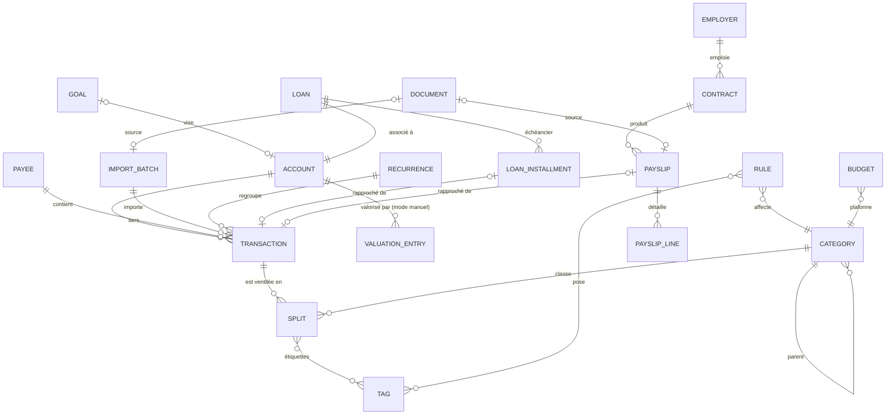

# Modèle de données

Modèle **cible** des données de Fluxo, introduit progressivement (M1 → M8). Il sera stocké dans une base SQLite chiffrée (SQLCipher) gérée par un service de données dédié.

## Règles transverses

| Règle             | Détail                                                                                                                                                                              |
| ----------------- | ----------------------------------------------------------------------------------------------------------------------------------------------------------------------------------- |
| Montants          | Entiers en **centimes** (`MinorUnits`) + code devise ISO 4217. Jamais de flottant. Les taux (cotisations, PAS) sont des décimaux stockés en millionièmes ou en texte décimal exact. |
| Dates             | Date **calendaire** `AAAA-MM-JJ` pour les opérations (pas de fuseau) ; horodatages UTC ISO 8601 pour l'audit et les imports ; mois `AAAA-MM`.                                       |
| Identifiants      | UUIDv7 (triables dans le temps, compatibles avec une future synchronisation).                                                                                                       |
| Suppression       | Archivage plutôt que suppression pour les entités référencées (comptes, catégories) ; suppression réelle pour les opérations, tracée dans l'audit.                                  |
| Audit             | Toute écriture produit une entrée de journal (entité, avant/après, origine : saisie, import, règle, IA).                                                                            |
| Données sensibles | IBAN, NIR, adresses : chiffrés avec la base, masqués à l'affichage, jamais journalisés.                                                                                             |

## Entités

| Entité                         | Champs principaux                                                                                                                                                                                                               | Jalon   |
| ------------------------------ | --------------------------------------------------------------------------------------------------------------------------------------------------------------------------------------------------------------------------------- | ------- |
| **Account**                    | nom, type (courant, épargne, carte différée, espèces, titres-restaurant, placement, prêt, autre actif), mode de suivi (transactionnel ou valorisation manuelle), établissement, devise, solde et date d'ouverture, IBAN chiffré, archivé | M2      |
| **Transaction**                | compte, date d'opération, date de valeur, montant, devise, montant converti, libellé brut, libellé affiché, tiers, statut (prévue, en attente, pointée, rapprochée), lot d'import, empreinte de déduplication, lien de virement  | M2      |
| **Split**                      | transaction, catégorie, montant (Σ = montant de la transaction), étiquettes, note                                                                                                                                                | M2      |
| **Category**                   | nom, parent, type (dépense, revenu, épargne, transfert), icône, couleur, ordre, archivée                                                                                                                                         | M2      |
| **Payee**                      | nom canonique, alias, catégorie par défaut                                                                                                                                                                                       | M2 / M4 |
| **Tag**                        | nom, couleur ; indépendant des catégories, posé sur une ou plusieurs ventilations (une même dépense peut porter plusieurs étiquettes)                                                                                           | M2      |
| **ImportBatch**                | fichier (nom, empreinte), format, profil, compte, période, compteurs, état, date                                                                                                                                                 | M3      |
| **Rule**                       | conditions, actions (catégorie et/ou étiquettes, renommage, marquer comme virement), priorité, active, statistiques d'application                                                                                              | M4      |
| **Recurrence**                 | tiers, périodicité, montant attendu ± tolérance, prochaine échéance, historique de prix                                                                                                                                         | M4      |
| **ValuationEntry**             | compte (en mode valorisation manuelle), date, valeur, note — historique d'un actif externe (placement, immobilier…)                                                                                                             | M8      |
| **Loan**                       | compte associé, nom, type (immobilier, consommation, auto, étudiant, autre), capital initial, taux nominal, TAEG, assurance emprunteur, durée, date de début, périodicité, mensualité, capital restant dû, statut              | M8      |
| **LoanInstallment**            | prêt, numéro, date d'échéance, part capital, part intérêts, part assurance, capital restant dû après échéance, statut (prévue, payée, rapprochée), transaction liée                                                             | M8      |
| **Budget**                     | catégorie, période, montant ou %, report                                                                                                                                                                                         | M8      |
| **Goal**                       | nom, montant cible, échéance, compte                                                                                                                                                                                             | M8      |
| **Employer** · **Contract**    | raison sociale ; type, statut cadre, temps de travail, convention collective, dates                                                                                                                                             | M6      |
| **Payslip** · **PayslipLine**  | voir ci-dessous                                                                                                                                                                                                                  | M6      |
| **Document**                   | type, empreinte (anti-doublon), taille, pages, état de traitement, résultat d'extraction ; **pas de fichier original conservé par défaut** (supprimé après extraction — export facultatif avant suppression)                   | M7      |
| **AuditEntry**                 | horodatage, entité, identifiant, avant, après, origine                                                                                                                                                                           | M1      |

### Étiquettes et corrélation transverse

Les étiquettes (`Tag`) sont posées sur la **ventilation** (`Split`), pas sur la transaction entière : une transaction non ventilée n'a qu'une seule part, le cas simple reste donc simple, et une transaction scindée peut porter des étiquettes différentes par part. Les étiquettes sont indépendantes des catégories et répondent à un besoin différent : une catégorie classe (une seule par part), une étiquette **corrèle** à travers les catégories (ex. l'étiquette « Abonnement téléphonique » peut regrouper des parts classées en « Télécom » comme en « Pro »). Les règles (M4) peuvent poser une catégorie, une ou plusieurs étiquettes, ou les deux. Voir [ADR-013](decisions.md#adr-013--étiquettes-posées-sur-la-ventilation-split-pas-sur-la-transaction).

### Épargne, patrimoine et crédits

- Un virement du compte courant vers un compte d'**épargne** (livret, PEA, assurance-vie…) est classé dans une catégorie de type `épargne` : il n'est **ni une dépense, ni un revenu**, mais apparaît distinctement dans le taux d'épargne et la synthèse mensuelle (M5), à la différence d'un virement neutre entre deux comptes courants (type `transfert`).
- Un compte en **mode valorisation manuelle** (placement, bien immobilier) n'a pas de transactions : sa valeur est une suite de `ValuationEntry` saisies périodiquement par l'utilisateur. Aucune cotation automatique par défaut (cohérent avec le principe local-first) ; une connexion facultative est envisagée après la v1 ([M10](../planning/M10-au-dela.md)).
- Un **crédit** (`Loan`) est représenté par un compte de type `prêt` associé à un échéancier (`LoanInstallment`) : capital et intérêts de chaque mensualité, capital restant dû après l'échéance, rapprochement facultatif avec la transaction de prélèvement. Le **patrimoine net** à une date donnée est une donnée dérivée : Σ comptes actifs (courant, épargne, placements valorisés) − Σ capital restant dû de tous les crédits.

## Bulletin de paie (France)

| Section              | Champs                                                                                                                                              | Contrôles                                       |
| -------------------- | --------------------------------------------------------------------------------------------------------------------------------------------------- | ----------------------------------------------- |
| En-tête              | période, date de paiement, employeur, contrat, emploi, classification                                                                               | —                                               |
| Rémunération de base | salaire de base, heures, taux horaire                                                                                                               | base = heures × taux (si horaire)               |
| Éléments variables   | type (astreinte, heures sup. 25/50 %, 13ᵉ mois, prime de vacances, ancienneté, objectifs, indemnités, avantages en nature), quantité, taux, montant | —                                               |
| Absences             | type, jours/heures, retenue                                                                                                                         | —                                               |
| Brut                 | total brut                                                                                                                                          | brut = base + variables − absences              |
| Cotisations (lignes) | libellé, groupe (santé, retraite, chômage, CSG/CRDS, prévoyance…), base, taux et montant salarial, taux et montant patronal                         | montant ≈ base × taux                           |
| Totaux               | cotisations salariales, cotisations patronales, net à payer avant impôt, net imposable, **montant net social**                                      | net avant impôt = brut − cotisations salariales |
| Impôt                | taux du prélèvement (personnalisé ou non), base, montant                                                                                            | PAS ≈ taux × net imposable                      |
| Après impôt          | titres-restaurant, acomptes, autres retenues ou ajouts                                                                                              | —                                               |
| Net payé             | montant viré                                                                                                                                        | net payé = net avant impôt − PAS ± autres       |
| Congés & RTT         | acquis, pris, soldes N et N-1                                                                                                                       | —                                               |
| Cumuls annuels       | brut, net imposable, PAS, heures                                                                                                                    | cumul = Σ des mois (tolérance d'arrondi)        |

Le modèle simplifié actuel (`src/shared/payslip.ts`) en est un sous-ensemble ; ses contrôles (`checkPayslip`) seront étendus au M6 et réutilisés pour valider les extractions automatiques (M7).

## Préférences (actuel)

Fichier `settings.json` dans le dossier de données de l'application, validé par `src/shared/settings-schema.ts` :

| Clé                 | Valeurs                               | Défaut   |
| ------------------- | ------------------------------------- | -------- |
| `schemaVersion`     | `1`                                   | `1`      |
| `theme`             | `system` · `light` · `dark`           | `system` |
| `locale`            | `fr-FR` · `en-US`                     | `fr-FR`  |
| `currency`          | `EUR` · `CHF` · `USD` · `GBP` · `CAD` | `EUR`    |
| `hideAmounts`       | booléen                               | `false`  |
| `contentProtection` | booléen                               | `false`  |

## Données dérivées

- **Agrégats mensuels** par compte et catégorie (revenus, dépenses, nombre d'opérations), mis à jour à l'écriture : base de toutes les analyses (M5).
- **Index** : date, compte, catégorie, empreinte d'import ; recherche plein texte (FTS5) sur les libellés.
