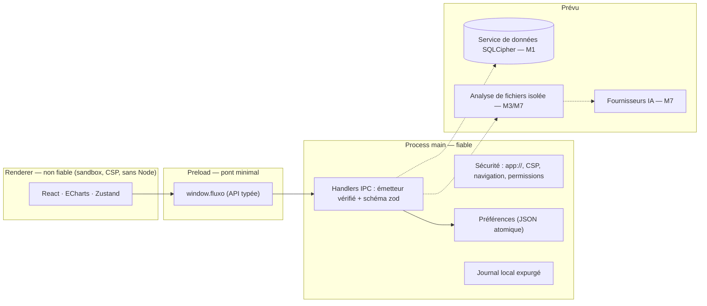

# Architecture — vue d'ensemble

## Stack

| Domaine               | Choix                                                       | Version (nov. 2026) |
| --------------------- | ----------------------------------------------------------- | ------------------- |
| Application de bureau | Electron                                                    | 45                  |
| Build                 | electron-vite (Vite 8 / Rolldown)                           | 6                   |
| Packaging             | electron-builder                                            | 26                  |
| Interface             | React + TypeScript strict                                   | 19 / 6.0            |
| Styles                | Tailwind CSS + design tokens CSS                            | 4                   |
| Graphiques            | Apache ECharts, importé « à la carte »                      | 6                   |
| État d'interface      | Zustand                                                     | 5                   |
| Routage               | wouter (routage par fragment `#/…`)                         | 3                   |
| Validation            | zod (process main)                                          | 4                   |
| Icônes                | lucide-react                                                | 1                   |
| Tests                 | Vitest + Testing Library (happy-dom), Playwright (Electron) | 5 / 1.65            |
| Qualité               | ESLint (typescript-eslint, règles typées) + Prettier        | 10 / 3              |

Prévu : SQLCipher + couche de requêtes typée (M1), TanStack Table/Virtual/Query (M2), pdf.js et tesseract.js (M7), SDK Anthropic et fournisseur local (M7), electron-updater (M9). Chaque dépendance est ajoutée **au jalon qui en a besoin**, pas avant.

## Processus et frontières de confiance



- **Renderer** : tout ce qui s'affiche. Considéré comme compromettable (contenu importé, dépendances front) : il n'a ni Node.js, ni accès disque, ni réseau.
- **Preload** : expose `window.fluxo`, une fonction par besoin métier, sans accès générique à `ipcRenderer`.
- **Process main** : seul détenteur des privilèges ; valide **toute** entrée venant du renderer.
- **Processus utilitaires** (à venir) : base de données et analyse de fichiers hors du process main, pour la réactivité et l'isolation.

## Démarrage

1. Avant `ready` : bac à sable global, enregistrement du schéma privé `app://`, verrou d'instance unique.
2. Au `ready` : journal local, menu minimal, durcissement de la session et de chaque contenu web, protocole `app://` avec CSP, préférences, handlers IPC.
3. Création de la fenêtre avec le fond du thème résolu (pas de flash), affichage à `ready-to-show`.
4. Le renderer charge les préférences par IPC, puis affiche l'interface.

## Arborescence

```text
fluxo/
├─ src/
│  ├─ main/            Process main : fenêtre, protocole, sécurité, IPC, préférences, journal
│  │  ├─ security/     CSP, chemins, URL, durcissement (fonctions pures testées)
│  │  ├─ ipc/          Fabrique de handlers validés + enregistrement des canaux
│  │  ├─ settings/     Lecture/écriture atomique, store des préférences
│  │  └─ logger/       Journal local + masquage des données personnelles
│  ├─ preload/         Pont contextBridge (window.fluxo) et ses types
│  ├─ renderer/        Interface React
│  │  └─ src/
│  │     ├─ app/       Coque : barre de titre, navigation, barre d'état
│  │     ├─ components/ Composants d'interface réutilisables, logo
│  │     ├─ features/  Pages : tableau de bord, paramètres, pages à venir
│  │     ├─ lib/       API, formatage, thème, graphiques (ECharts)
│  │     ├─ i18n/      Dictionnaires typés FR/EN
│  │     ├─ stores/    État (Zustand)
│  │     └─ styles/    Tokens de design, styles globaux
│  └─ shared/          TypeScript pur partagé : contrat IPC, préférences, montants, mois, bulletins, démo
├─ tests/e2e/          Tests Playwright sur la build de production
├─ build/              Ressources de packaging (icône, entitlements)
├─ scripts/            Outils (lanceur Vitest, génération d'icônes)
└─ docs/               Cette documentation
```

## Règles de dépendances (vérifiées par ESLint)

| Code           | Peut importer                                            | Ne doit jamais importer                            |
| -------------- | -------------------------------------------------------- | -------------------------------------------------- |
| `src/shared`   | rien d'autre que `src/shared` et des bibliothèques pures | `electron`, React, `node:*`, main/preload/renderer |
| `src/renderer` | `src/shared`, bibliothèques front                        | `electron`, `node:*`, `src/main`, le preload       |
| `src/preload`  | `electron` (sous-ensemble sandbox), `src/shared`         | le reste                                           |
| `src/main`     | tout ce qui est côté Node, `src/shared`                  | le renderer                                        |

Règles de sécurité outillées : pas d'`innerHTML`/`outerHTML`/`insertAdjacentHTML`, pas de `dangerouslySetInnerHTML`, pas d'`eval` ni de `new Function`, promesses obligatoirement gérées.

## Bundling & dépendances

- Tout ce qui peut être bundlé est en `devDependencies` : rien n'est copié dans `app.asar/node_modules`, l'application reste légère.
- Seules les dépendances **natives** du process main (SQLCipher au M1) iront en `dependencies` et seront externalisées.
- Le renderer est minifié ; le main ne l'est pas (traces d'erreur lisibles dans le journal).

## Conventions

- **Argent** : entiers en centimes (`MinorUnits`) ; formatage uniquement à l'affichage (`Intl.NumberFormat`).
- **Mois** : chaînes `AAAA-MM`, calculs en UTC, indépendants du fuseau horaire.
- **Textes** : jamais en dur dans les composants ; passer par `useT()` (dictionnaires typés, l'anglais doit avoir les mêmes clés que le français).
- **Tests** : à côté du code (`*.test.ts[x]`) ; E2E dans `tests/e2e`.
- **Commits** : Conventional Commits (`feat:`, `fix:`, `docs:`…).

## Scripts

| Commande                             | Rôle                                                |
| ------------------------------------ | --------------------------------------------------- |
| `npm run dev`                        | Application en développement (rechargement à chaud) |
| `npm run build`                      | Build de production (`out/`)                        |
| `npm start`                          | Lance la build de production                        |
| `npm run check`                      | Types + lint + format + tests unitaires             |
| `npm test` · `npm run test:coverage` | Tests unitaires (via `scripts/vitest.mjs`)          |
| `npm run test:e2e`                   | Build + tests de bout en bout                       |
| `npm run icons`                      | Génère `build/icon.png` depuis `build/icon.svg`     |
| `npm run package` · `npm run dist`   | Application non empaquetée · installeurs            |
