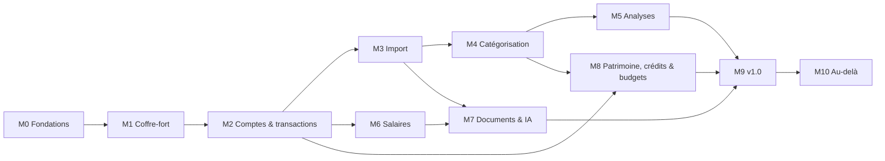

# Feuille de route

Fluxo est livré par **jalons** successifs, ordonnés par importance et par logique d'implémentation : chaque jalon s'appuie sur les précédents et produit une application utilisable.

> Dernière mise à jour : 25 novembre 2026 — **M0 à M7 livrés** ; prochain jalon : **M8** (patrimoine, crédits, budgets & prévisions).

## Vue d'ensemble

| Jalon                            | Titre                         | Objectif                                                                                | Statut   | Taille | Version         |
| -------------------------------- | ----------------------------- | --------------------------------------------------------------------------------------- | -------- | ------ | --------------- |
| [M0](M0-fondations.md)           | Fondations                    | Socle Electron sécurisé, interface, design, i18n, tests, CI                             | ✅ Livré | M      | 0.1             |
| [M1](M1-coffre-fort.md)          | Coffre-fort local             | Base chiffrée, déverrouillage, sauvegardes, migrations                                  | ✅ Livré | L      | 0.2             |
| [M2](M2-comptes-transactions.md) | Comptes & transactions        | Registre rapide, ventilation, virements, catégories                                     | ✅ Livré | L      | 0.3             |
| [M3](M3-import-releves.md)       | Import des relevés            | CSV, OFX/QFX, QIF, CAMT.053, MT940, doublons, annulation                                | ✅ Livré | L      | 0.4 · **Alpha** |
| [M4](M4-categorisation.md)       | Catégorisation automatique    | Règles, apprentissage local, abonnements                                                | ✅ Livré | L      | 0.5             |
| [M5](M5-analyses.md)             | Analyses & synthèses          | Filtres globaux, synthèse mensuelle, exploration                                        | ✅ Livré | L      | 0.6 · **Bêta**  |
| [M6](M6-salaires.md)             | Salaires & bulletins          | Bulletin détaillé, du brut au net, tableau de bord salaire                              | ✅ Livré | XL     | 0.7             |
| [M7](M7-documents-ia.md)         | Documents & IA                | Extraction PDF/OCR, IA locale ou cloud consentie                                        | ✅ Livré | XL     | 0.8             |
| [M8](M8-patrimoine-budgets.md)   | Patrimoine, crédits & budgets | Crédits, amortissement, patrimoine net, enveloppes, prévisions, simulation à long terme | ⬜       | XL     | 0.9 · **RC**    |
| [M9](M9-distribution.md)         | Distribution v1.0             | Installeurs signés, mises à jour, audits                                                | ⬜       | XL     | **1.0**         |
| [M10](M10-au-dela.md)            | Au-delà de la v1              | Synchronisation, mobile, open banking, packs pays                                       | 💭       | —      | 1.x             |

Taille = complexité relative (S < M < L < XL), pas une durée.

## Dépendances

**Parallélisation possible** : M6 (salaires, saisie manuelle) ne dépend que de M2 et peut avancer en parallèle de M3–M5. M8 (patrimoine, crédits) ne dépend que de M2 pour ses lots crédits/patrimoine et peut démarrer avant M3–M5 ; ses lots budgets, prévisions et simulation attendent M4.

## Pourquoi cet ordre ?

1. **Fondations puis données** : la sécurité (isolation, chiffrement) et le modèle de données sont très coûteux à changer après coup ; ils passent en premier.
2. **Le cœur avant l'automatisation** : on sait saisir et afficher une transaction (M2) avant d'en importer des milliers (M3), puis de les catégoriser (M4) et de les analyser (M5).
3. **Déterministe avant IA** : les imports structurés et la saisie de bulletins (M3, M6) définissent les schémas que l'IA devra remplir (M7). L'IA accélère, elle ne remplace pas.
4. **Alpha dès M3** : à partir de l'import, Fluxo est utilisable au quotidien par des testeurs.
5. **Patrimoine et crédits avec les budgets (M8)** : un crédit ou un compte valorisé manuellement est une extension du modèle de comptes (M2) ; le patrimoine net est une anticipation, comme un budget. Les regrouper évite un jalon supplémentaire qui aurait décalé la numérotation (voir [propositions, organisation des jalons](propositions.md#2-propositions-sur-lorganisation-des-jalons)).

## Jalons de version

| Version       | Après | Public               | Promesse                                                                                                            |
| ------------- | ----- | -------------------- | ------------------------------------------------------------------------------------------------------------------- |
| 0.1           | M0    | Développeurs         | Le socle compile, se teste et se lance sur les 3 OS.                                                                |
| 0.4 « Alpha » | M3    | Testeurs volontaires | Suivre ses comptes à partir de ses relevés. Formats de données encore susceptibles d'évoluer (migrations fournies). |
| 0.6 « Bêta »  | M5    | Testeurs élargis     | Comprendre ses finances : catégories fiables, analyses complètes.                                                   |
| 0.9 « RC »    | M8    | Public averti        | Fonctionnellement complet, en cours de stabilisation.                                                               |
| 1.0           | M9    | Grand public         | Installeurs signés, mises à jour automatiques, audits réalisés.                                                     |

## Processus

- Chaque jalon a sa page : objectif, périmètre, plan d'action par lots, critères d'acceptation, risques.
- Une tâche est cochée quand elle est **fusionnée, testée et documentée**.
- Les [propositions](propositions.md) deviennent des tâches après validation ; les [questions ouvertes](questions-ouvertes.md) bloquantes sont tranchées avant le démarrage du jalon concerné.
- Un jalon est clos quand tous ses critères d'acceptation sont remplis et que la CI est verte sur les trois systèmes.
